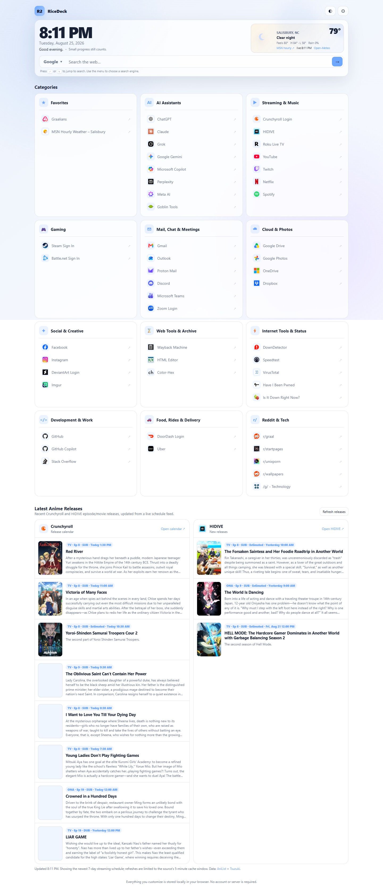
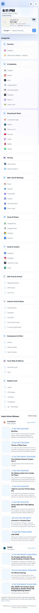

# RiceDeck

RiceDeck is a polished personal start page for Rice2k: a fast, customizable browser dashboard with search, favorites, live weather, anime release feeds, gaming links, service tools, and a Windows installer for setting it as a browser home/startup page.

[Live demo](https://rice2k.github.io/rice2k-startdeck/) · [Download Windows setup ZIP](releases/RiceDeck_Windows_Setup.zip)

**New:** [Rice2K Project Explorer — search all public projects](https://rice2k.github.io/rice2k-startdeck/projects/) · [Search starred repositories](https://rice2k.github.io/rice2k-startdeck/projects/?scope=starred) · [All public repositories (static)](https://rice2k.github.io/rice2k-startdeck/projects/all-projects.html)

## Screenshots





## Features

- Compact clock, search, and dashboard layout built for everyday use.
- Live Salisbury, NC weather card with current temperature, condition artwork, feels-like temperature, high/low, rain chance, cached loading, and MSN Weather link.
- Anime release dashboard for Crunchyroll and HIDIVE using Tsuzuki schedule data plus AniList metadata.
- Favorites and categorized bookmarks for everyday browsing.
- Gaming shortcuts, including Steam sign-in and Battle.net sign-in.
- Services, tools, and internet-status links such as Speedtest, DownDetector, VirusTotal, Have I Been Pwned, and related utilities.
- Settings panel for theme, accent color, category visibility, ordering, and export/import backup.
- All bookmark, provider, weather, and release links open in a new tab with `noopener noreferrer`.
- Single-file static app: no build step, no server requirement, and works locally or through GitHub Pages.
- Windows setup package that installs to `C:\Startpage`, configures supported browsers, and includes a restore utility.

## Live Demo

The GitHub Pages version is published at:

https://rice2k.github.io/rice2k-startdeck/

Because this is a static start page, the live version serves the same `index.html` used by the local installer. Browser-stored settings are saved locally on each device.

## Installation

### Use The Live Version

1. Open the [live demo](https://rice2k.github.io/rice2k-startdeck/).
2. Set that URL as your browser homepage or startup page.
3. Use the settings button in RiceDeck to personalize the dashboard.

### Install Locally On Windows

1. Download [`RiceDeck_Windows_Setup.zip`](releases/RiceDeck_Windows_Setup.zip).
2. Extract the ZIP completely.
3. Close open browser windows.
4. Run `Setup.cmd`.

The installer creates `C:\Startpage`, copies the page and helper files there, and configures supported browser home/startup settings when possible.

Supported browsers include Microsoft Edge, Google Chrome, Firefox, Brave, Vivaldi, Opera, and Opera GX. The package also includes `Restore_Browser_Settings.cmd` for reverting backed-up browser settings.

## Project Structure

```text
index.html                         Static start page used by GitHub Pages
projects/                          Separate searchable GitHub project explorer (HTML/CSS/JS)
installer/                         Windows setup and restore scripts
releases/RiceDeck_Windows_Setup.zip Downloadable installer package
assets/screenshots/                Actual captured screenshots of the page
```

## Search Your GitHub Projects

The [Rice2K Project Explorer](https://rice2k.github.io/rice2k-startdeck/projects/) is a separate, no-cost static directory under this GitHub Pages site. Search public projects by repository name, topic, keyword, category, or language; browse public starred repositories; and sort by update date or stars. It uses GitHub's public API, caches responses briefly, and never requests private repository access.

For implementation and limitations, see [Project Explorer documentation](projects/README.md).

## Data And Credits

- Weather data: [Open-Meteo](https://open-meteo.com/)
- Detailed weather destination: [MSN Weather](https://www.msn.com/en-us/weather)
- Anime schedule data: [Tsuzuki](https://tsuzuki.top/)
- Anime metadata: [AniList](https://anilist.co/)
- Original visual inspiration and credits retained in the page footer: TB-96, jeroenpardon, and Material Design Icons.

## Notes

The installer sets browser homepage/startup behavior where supported. It does not force Chrome or Edge's protected new-tab page through enterprise policy or extensions.
